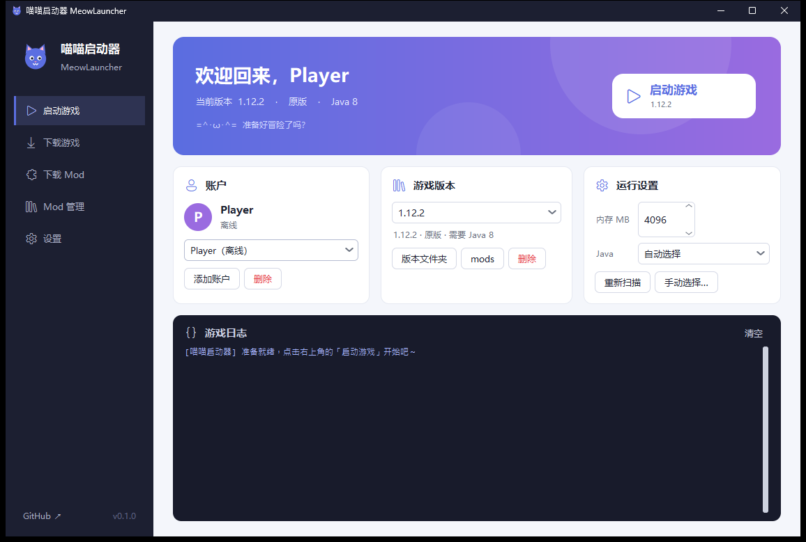
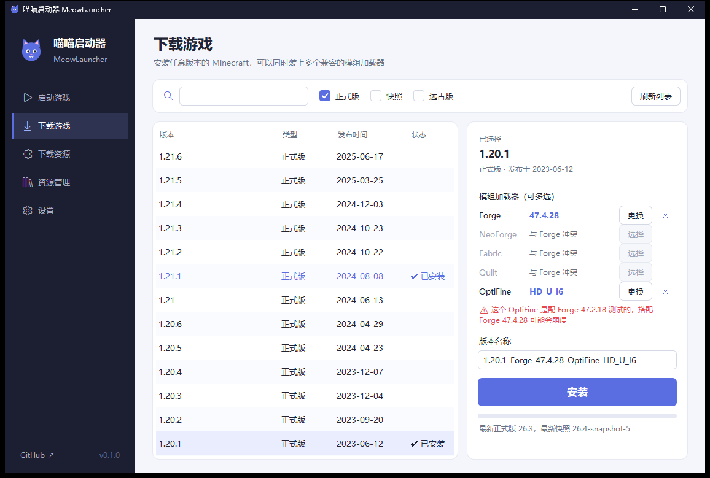
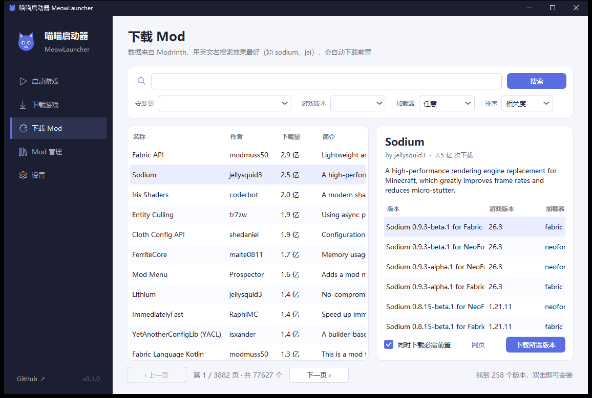

# 喵喵启动器 MeowLauncher =^･ω･^=

一个类似 HMCL 的 Minecraft 启动器，纯 Python 编写，**不需要安装任何第三方库**（只用标准库 + tkinter）。







## 运行

需要 Python 3.9+ 和 Java（游戏需要的版本：1.20.5+ 要 Java 21，1.17–1.20.4 要 Java 17，更老的要 Java 8）。

```bash
python main.py
```

Windows 下也可以直接双击 `启动.bat`。

## 功能

| 页面 | 功能 |
| --- | --- |
| 启动游戏 | 多账户（离线 / 微软正版 / 外置登录）、选择版本、内存、自动/手动选择 Java、实时游戏日志；「管理」可以**更换、卸载、加装模组加载器** |
| 下载游戏 | 列出全部版本（正式版 / 快照 / 远古版，可搜索），像 HMCL 一样**多选**加载器：**Forge / NeoForge / Fabric / Quilt / OptiFine**，冲突的组合会自动禁用 |
| 下载资源 | 像 HMCL 一样的三级页面：搜索列表（图标、分类、加载器标签）→ 项目详情（推荐版本 + 按 Minecraft 版本分组）→ 下载窗口（**必需依赖自动安装，可选依赖勾选安装**），支持 Mod、光影、资源包，来源可选 **Modrinth / CurseForge**，也可以下载到本机目录 |
| 资源管理 | 管理某个版本的 Mod（启用 / 禁用 / 删除）、光影和资源包，支持从本机添加 |
| 设置 | 游戏目录、下载源（BMCLAPI 镜像 / 官方）、下载线程数、窗口大小、额外 JVM 参数 |

- 下载源默认使用 BMCLAPI 镜像，镜像失败会自动回落到官方源；所有文件做 sha1 校验，多线程下载。
- 每个版本的游戏目录是 `.minecraft/versions/<版本名>`（版本隔离），存档、Mod、配置互不干扰。
- 启动前会自动补全缺失的游戏文件。
- Forge / NeoForge 使用官方安装器：解出安装器里的文件、下载依赖、运行安装处理器（需要本机有 Java）。
  1.12.2 及更早的 Forge 也支持安装，但运行需要 **Java 8**（LaunchWrapper 在新 Java 上跑不起来）。
- 游戏日志会从 log4j 的 XML 格式还原成普通文本显示。
- 加载器兼容规则和 HMCL 一致：OptiFine 只能和 Forge 一起装（作为 Mod 放进 mods），其余加载器两两互斥。
  OptiFine 单独安装时会像官方安装器一样用 Patcher 生成补丁库、通过 launchwrapper 启动；OptiFine 的列表和下载来自 BMCLAPI。
- 选加载器版本时可以「从本机文件」安装或升级：支持 Forge / NeoForge 安装器 jar、OptiFine jar（保留官网文件名）、
  Fabric / Quilt 的版本 json，会校验文件对应的游戏版本。
- 启动页「下载 Java」可以一键下载 Mojang 官方的 Java 8 / 16 / 17 / 21 / 25，装到游戏目录的 `runtime` 文件夹并自动选用；
  启动时如果本机没有合适的 Java（例如 1.16.5 及更早要 Java 8），会提示自动下载，装好后接着启动。
- **CurseForge** 的 API Key 内置在 `mcl/_private.py`（不在公开仓库里，打包时会一起带上）。自己从源码运行时，
  到 [CurseForge 控制台](https://console.curseforge.com/) 免费申请一个，填进这个文件即可；没有 Key 时只能用 Modrinth。
  作者不允许第三方启动器下载的文件会提示到网页手动下载，不会绕过作者的设置。
- 项目图标支持 **WebP**：Windows 上调用系统自带的 WIC 解码（Win10 1809+ / Win11），装了 Pillow 则优先用 Pillow，仍然不需要第三方库。
- 依赖会**递归展开**（依赖的依赖），分析过的项目会跳过，循环依赖也不会死循环。安装前会检查 mods 文件夹：
  既用 sha1 向 Modrinth 反查，也读取 jar 里的 Mod ID（`fabric.mod.json`、`quilt.mod.json`、`mods.toml`），从别处下载的依赖也能认出来。
- 每个版本目录下的 `meow.json` 记录装了哪些加载器；别的启动器装的版本会从版本 json 自动识别。

## 账户

- **离线**：随便起个名字。
- **外置登录**：支持 LittleSkin 等兼容 authlib-injector 的皮肤站，填服务器地址和账号密码即可（密码不保存）。启动时会自动下载 authlib-injector。
- **微软正版**：启动器已内置 Client ID，玩家直接点「添加账户 → 微软正版」按提示登录即可。

> 给想换成自己 Client ID 的开发者（在「设置」页填写即可覆盖内置的）：
>
>  1. 到 [Azure 应用注册](https://portal.azure.com/#view/Microsoft_AAD_RegisteredApps/ApplicationsListBlade) 新建应用，账户类型选「仅个人 Microsoft 帐户」，重定向 URI 不用填；
>  2. 在应用的「身份验证」里把「允许公共客户端流」设为「是」；
>  3. 复制「应用程序(客户端) ID」，填到启动器「设置」页；
>  4. 到 [Mojang 审核申请](https://aka.ms/mce-reviewappid) 提交这个 ID，审核通过前 Minecraft 会返回 403。

账户保存在 `accounts.json`，里面有登录令牌，不要分享给别人。把启动器打包发给朋友时，
不要带上 `accounts.json`、`config.json` 和 `.minecraft/`（`.gitignore` 已经排除了它们）。

## 目录结构

```
main.py          入口
mcl/net.py       下载、镜像、重试、校验
mcl/game.py      版本清单、安装原版/Fabric、库与资源文件、拼启动参数
mcl/java.py      扫描本机 Java 并按需求选择
mcl/auth.py      账户：离线、微软设备码登录、authlib-injector 外置登录
mcl/imaging.py   图片解码缩放（WebP 等，Windows WIC / Pillow）
mcl/runtime.py   下载 Mojang 官方 Java 运行时
mcl/mods.py      Modrinth / CurseForge 搜索、版本、前置依赖解析与下载
mcl/gui.py       tkinter 界面
mcl/theme.py     界面主题：纯 Python 生成抗锯齿圆角图片，给 ttk 控件换皮
```

## 暂不支持

- CurseForge：API 需要申请 key
- 自动下载 Java

## 许可证

[MIT](LICENSE)。Minecraft 是 Mojang Studios 的商标，本项目与 Mojang、Microsoft 无关。
